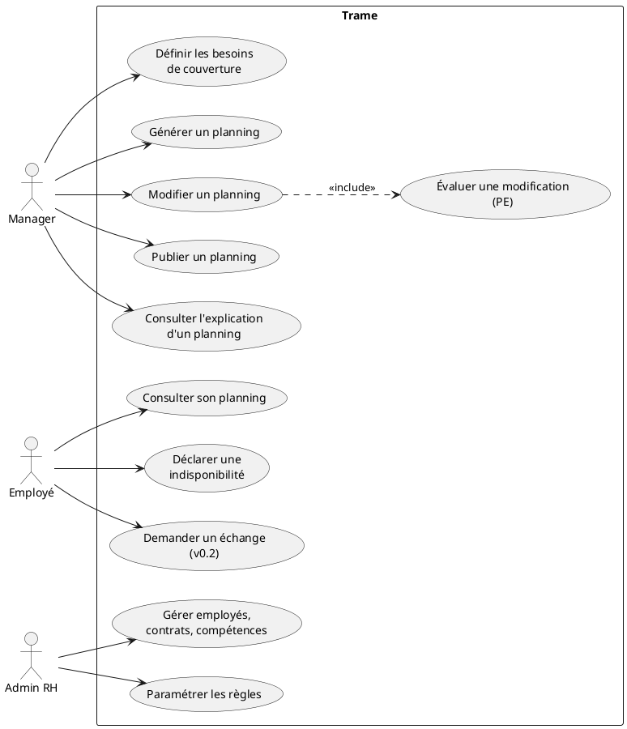
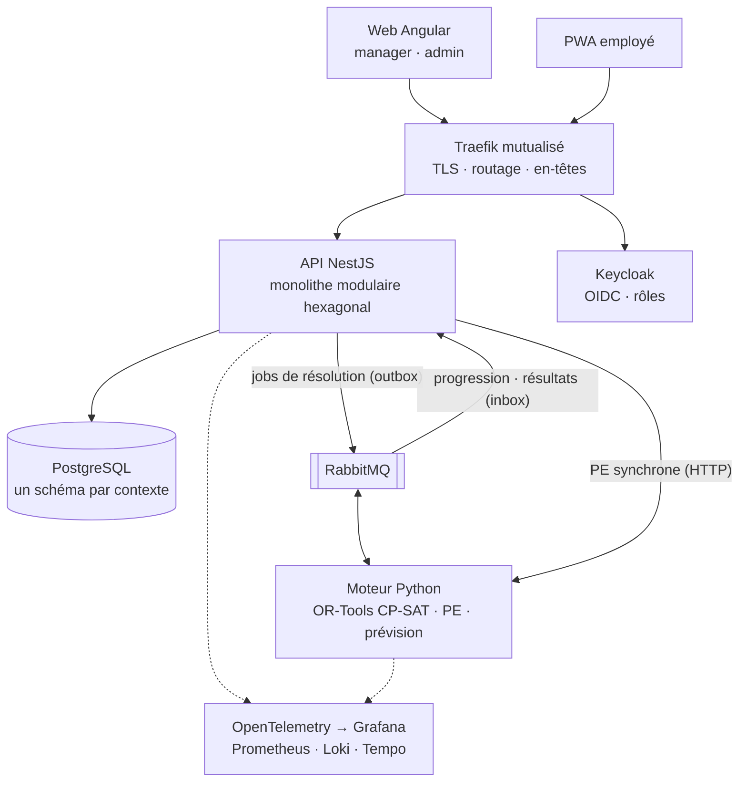

# Trame — Document de cadrage

> Version 0.4 · 1er novembre 2026 · Statut : validé, audit et deux revues croisées de Codex intégrés, sauf les points ouverts du §18
> Décisions détaillées : `docs/adr/` · Backlog : `docs/backlog-v0.1.md` · Règles pour les agents : `AGENTS.md`

## 1. Vision

Trame planifie automatiquement les équipes d'un entrepôt logistique. Le produit prévoit la charge, calcule les besoins en effectifs et génère un planning conforme au Code du travail et aux contrats. Il explique ce planning et le réajuste en temps réel quand le terrain change.

**Pitch** : « Ex-responsable logistique, j'ai construit l'outil de planification qui me manquait. »

## 2. Problème

- Les plannings d'entrepôt se font encore souvent sur tableur. Ça coûte des heures de manager chaque semaine et ça produit des erreurs de conformité (repos, durées maximales), des iniquités (week-ends, nuits) et du sous-effectif pendant les pics.
- Une absence de dernière minute oblige à tout reprendre à la main.
- Quand aucun planning valide n'existe, personne ne sait dire pourquoi.

## 3. Positionnement

Les outils de planning du marché (Skello, Planday, Quinyx…) couvrent la saisie et la diffusion. Trame se différencie sur trois points :

1. **Génération optimisée** sous contraintes dures (légales, contractuelles) et souples (préférences, équité).
2. **Explicabilité** : pourquoi ce planning, pourquoi aucun planning n'est possible, quelles règles bloquent.
3. **Édition assistée** : chaque modification manuelle est évaluée instantanément par la PE (§9).

## 4. Acteurs

| Acteur                | Canal                               | Besoins principaux                                                                        |
| --------------------- | ----------------------------------- | ----------------------------------------------------------------------------------------- |
| Manager de site       | Web                                 | Définir les besoins, générer, ajuster, publier                                            |
| Employé               | PWA mobile (web responsive en v0.1) | Consulter son planning, déclarer ses indisponibilités et préférences, demander un échange |
| Admin RH              | Web                                 | Gérer contrats, compétences, règles légales et accords                                    |
| Moteur d'optimisation | Système                             | Résoudre, évaluer, expliquer                                                              |
| Keycloak              | Système                             | Authentifier, porter les rôles                                                            |

## 5. Cas d'utilisation

## 6. Règles métier

### Règles légales et contractuelles

Un planning proposé ne les viole jamais. Ce sont des valeurs par défaut, paramétrables par site.

| Règle                                                      | Défaut                                                                                                      | Référence                | Version |
| ---------------------------------------------------------- | ----------------------------------------------------------------------------------------------------------- | ------------------------ | ------- |
| Habilitation requise (ex. CACES)                           | —                                                                                                           | —                        | v0.1    |
| Un seul shift à la fois                                    | —                                                                                                           | —                        | v0.1    |
| Repos quotidien                                            | ≥ 11 h consécutives                                                                                         | C. trav. art. L3131-1    | v0.1    |
| Durée quotidienne maximale (temps effectif)                | 10 h                                                                                                        | art. L3121-18            | v0.1    |
| Durée hebdomadaire maximale                                | 48 h                                                                                                        | art. L3121-20            | v0.1    |
| Durée hebdomadaire moyenne sur 12 semaines                 | ≤ 44 h                                                                                                      | art. L3121-22            | v0.1    |
| Jours travaillés par semaine                               | 6 au maximum                                                                                                | art. L3132-1             | v0.1    |
| Repos hebdomadaire                                         | ≥ 35 h consécutives (24 h + 11 h)                                                                           | art. L3132-2             | v0.1    |
| Repos dominical                                            | Dimanche non travaillé. Dérogation possible seulement si son fondement juridique est renseigné pour le site | art. L3132-3 et suivants | v0.1    |
| Période de nuit                                            | 21 h–6 h, sauf accord (9 h consécutives entre 21 h et 7 h, incluant minuit–5 h)                             | art. L3122-20, L3122-2   | v0.1    |
| Travailleur de nuit : durée quotidienne maximale           | 8 h                                                                                                         | art. L3122-6             | v0.1    |
| Travailleur de nuit : moyenne hebdomadaire sur 12 semaines | ≤ 40 h                                                                                                      | art. L3122-7             | v0.1    |
| Pause                                                      | ≥ 20 min consécutives dès 6 h de travail                                                                    | art. L3121-16            | v0.1    |
| Indisponibilités et absences                               | Déclarées                                                                                                   | —                        | v0.1    |
| Volume contractuel                                         | Min/max du contrat                                                                                          | Contrat                  | v0.1    |
| Jours fériés                                               | Calendrier et accord du site                                                                                | Code du travail, accords | v0.2    |
| Coupures des temps partiels                                | Interruptions limitées en nombre et en durée                                                                | Code du travail, accords | v0.2    |

> **Statut de travailleur de nuit : il est calculé, pas seulement déclaré** (art. L3122-5). Un salarié est travailleur de nuit s'il remplit l'un de ces deux critères :
>
> - il fait, selon son horaire habituel, au moins 3 h de travail de nuit au moins deux fois par semaine ;
> - il atteint un seuil d'heures de nuit sur une période de référence : 270 h sur 12 mois consécutifs à défaut d'accord (art. L3122-23).
>
> Le contrat indique seulement si le salarié peut travailler de nuit. Le moteur compte les heures de nuit de chaque shift sur la période de nuit du site, historique de 12 mois compris. Il applique les limites du travailleur de nuit dès qu'un critère est atteint, ou le serait par le planning proposé. Cette lecture est prudente : appliquer ces limites plus tôt ne viole aucune règle.
>
> Revérifier toutes ces valeurs sur Légifrance avant tout usage réel. Les accords collectifs peuvent les moduler dans les limites légales.

### Couverture

La couverture minimale par créneau et par compétence est un **objectif**, pas une règle légale. En mode standard, un manque est autorisé mais fortement pénalisé et toujours chiffré. En mode strict, il est interdit (§8). Un planning peut donc être légal (`FEASIBLE`) tout en laissant un créneau sous-couvert : l'interface affiche les deux informations séparément.

### Délai de prévenance

Modifier un planning déjà publié trop près de sa date est encadré (notamment pour les temps partiels). Le délai est paramétrable par site. Une modification qui ne le respecte pas n'est pas bloquée mais renvoie `UNCERTAIN` (§9), et toute modification après publication est tracée dans un journal (qui, quand, quoi, motif).

### Contraintes souples

Elles sont pondérées, et les poids se règlent par site.

- Préférences de créneaux des employés.
- Équité de répartition des week-ends et des nuits.
- Minimisation des heures supplémentaires.
- Stabilité : en re-planification, minimiser les changements par rapport au planning publié.
- Compacité : éviter les shifts isolés et les journées hachées.

## 7. Shifts, horizon et temps

- **Shifts** : en v0.1, chaque site définit des créneaux types (par exemple matin 6 h–14 h, après-midi 14 h–22 h, nuit 22 h–6 h). Un shift est un créneau × un poste × un jour. Les horaires libres viendront après la v0.2.
- **Pauses et temps effectif** : un créneau type a une amplitude (début, fin) et une pause positionnée (durée et heure de début, par exemple 30 min à 2 h du début). Le temps de travail effectif est l'amplitude moins la pause. Les règles de durée portent sur le temps effectif, et la règle de pause vérifie la pause positionnée.
- **Nuit du passage à l'heure d'hiver** : le créneau 22 h–6 h y dure 9 h d'amplitude, soit 8 h 30 de temps effectif avec 30 min de pause, au-delà de la limite du travailleur de nuit. Par défaut, Trame raccourcit ce créneau d'1 h pour cette nuit-là et le signale au manager à la génération. L'heure perdue (5 h–6 h) apparaît comme un manque de couverture explicite, dans le planning comme dans l'explication. Le site peut choisir une relève à la place.
- **Horizon** : la semaine ISO. Les 7 derniers jours publiés, les compteurs des 12 dernières semaines et le compteur d'heures de nuit des 12 derniers mois entrent dans le modèle comme données figées. Sans eux, les règles qui traversent la frontière de semaine (repos de 11 h entre dimanche soir et lundi matin, repos hebdomadaire, moyennes sur 12 semaines) seraient fausses.
- **Temps** (ADR-0019) : les instants sont stockés en UTC, et chaque site porte son fuseau IANA (`Europe/Paris`). Jours, semaines et durées se calculent dans ce fuseau. Une nuit de changement d'heure dure donc 7 h ou 9 h, et des tests ciblent ces nuits pour chaque règle de durée. Aucune date naïve dans le code.

## 8. Modèle d'optimisation (esquisse)

- **Ensembles** : $E$ employés, $S$ shifts, $D$ jours, $W$ semaines.
- **Variables** :
  - $x_{e,s} \in \{0,1\}$ vaut 1 si l'employé $e$ tient le shift $s$ ;
  - $u_s \ge 0$ est le manque de couverture sur $s$ (variable d'écart).
- **Contraintes** (exemples) :
  - couverture : $\sum_e x_{e,s} + u_s \ge b_s$ ;
  - habilitation : $x_{e,s} = 0$ si $e$ n'a pas la compétence requise par $s$ ;
  - incompatibilité (chevauchement, ou repos < 11 h entre $s$ et $s'$) : $x_{e,s} + x_{e,s'} \le 1$ ;
  - durée quotidienne : $\sum_{s \in d} \mathrm{dur}_s \, x_{e,s} \le 600$ min ;
  - durée hebdomadaire : $\sum_{s \in w} \mathrm{dur}_s \, x_{e,s} \le 2880$ min.
- **Objectif** : $\min \; M \sum_s u_s + \sum_k \lambda_k \, \mathrm{pénalité}_k$, avec $M \gg \lambda_k$.
- **Deux modes de résolution** :
  - **Standard** ($u_s$ pénalisé) : la couverture est un objectif. Le manque restant est chiffré par créneau et par compétence (« 3 caristes CACES requis samedi matin, 2 affectés ») : c'est le diagnostic livré en v0.1.
  - **Strict** ($u_s = 0$) : la couverture devient une règle. Chaque famille de règles est activée par un littéral d'hypothèse. En cas d'infaisabilité, CP-SAT renvoie un sous-ensemble suffisant de règles en conflit, pas forcément minimal. L'analyse impose un seul worker (documentation d'OR-Tools). Le spike US-064 mesure son coût et la qualité des explications sur des cas Trame, et fixe la granularité des hypothèses et le libellé des explications. Le diagnostic minimal et lisible arrive en v0.3.
- **Issue d'une résolution** : chaque résolution se termine dans un état explicite, affiché tel quel dans l'interface :
  - `OPTIMAL` ou `FEASIBLE` : un planning légal a été trouvé, prouvé optimal ou non ;
  - `INFEASIBLE` : aucun planning légal n'existe, même en mode standard (par exemple des minimums contractuels impossibles à tenir) ;
  - `UNKNOWN` : la limite de temps est atteinte sans aucune solution ;
  - `CANCELLED` : annulée par le manager, avec la meilleure solution trouvée s'il y en a une.
- **Re-planification** : la stabilité est imposée par une pénalité explicite sur chaque changement par rapport au planning publié (contrainte souple). Le planning publié est aussi donné au solveur comme point de départ (hints), sans garantie qu'il l'utilise ni qu'il gagne du temps : le spike mesure l'effet.
- **Reproductibilité** (ADR-0020) : chaque résolution stocke son problème, ses paramètres (graine, limite de temps, nombre de workers) et sa solution, qu'on peut toujours réafficher et auditer. En multi-thread, CP-SAT n'est pas déterministe : une nouvelle résolution identique n'est garantie qu'en mode déterministe (1 worker), plus lent, réservé aux tests et aux benchmarks.

## 9. PE — Procédure d'Évaluation

- **Entrée** : un planning et une modification (affecter, retirer, déplacer, échanger).
- **Sortie** : `FEASIBLE` | `INFEASIBLE` | `UNCERTAIN` (affichés RÉALISABLE / IRRÉALISABLE / INCERTAIN dans l'UI), avec la liste des violations (règle, employé, période, message) et l'impact sur le score.
- **`UNCERTAIN`** : aucune règle dure n'est violée sur l'horizon connu, mais il existe un risque :
  - une règle glissante dépend de semaines pas encore planifiées (moyennes sur 12 semaines) ;
  - la modification ne respecte pas le délai de prévenance (§6) ;
  - la couverture passe sous la borne haute de l'intervalle de prévision (à partir de la v0.3).
- **Règles définies une seule fois, dans le moteur** (ADR-0005, précisée par ADR-0020) : chaque règle est un objet qui porte à la fois sa contrainte CP-SAT et son évaluation. Des tests de propriétés vérifient que les deux formes sont cohérentes, dans les deux sens.
- **Légalité et couverture séparées** : `FEASIBLE` porte sur les règles légales et contractuelles. L'effet sur la couverture est rapporté à part (« samedi matin : 1 cariste manquant »).
- **Trois consommateurs** : l'UI (drag & drop), les tests du solveur (la PE sert d'oracle) et l'agent IA (avant toute écriture, v0.4).
- **Latence cible** : p95 < 200 ms par évaluation.

## 10. Architecture

### Principes

- **API = monolithe modulaire**, hexagonal + DDD. Bounded contexts :
  - `organization`, `staff`, `rules`, `demand`, `scheduling` ;
  - puis `swaps` (v0.2), `forecasting` (v0.3), `assistant` (v0.4).
- **Le moteur est sans état** : il reçoit un problème complet et renvoie une solution et son explication. Il ne lit ni n'écrit jamais la base.
- **Données** (ADR-0022) :
  - chaque agrégat porte un `organizationId` dès la v0.1, et chaque requête filtre dessus. L'isolation par la base (Row Level Security) arrive en v1.0 sans réécriture ;
  - un schéma Postgres par contexte, sans jointure ni clé étrangère entre contextes : les références croisées passent par identifiant ;
  - migrations expand/contract : une migration ne casse jamais la version précédente de l'API. Revenir à l'image précédente reste donc sûr, et c'est testé sur staging.
- **Autorisation par objet** : au-delà de l'organisation, chaque accès vérifie la propriété (un employé ne voit que ses données). Chaque endpoint a un test d'accès croisé.
- **Socle réutilisable** (ADR-0026) : le socle générique de l'API (horloge, erreurs, configuration, logs, santé, outbox, inbox, idempotence, authentification, audit) vit dans `libs/platform`, sans aucun terme de planification. Il se reprend dans un autre projet par simple copie.
- **Démo publique** (ADR-0025) : chaque visiteur reçoit sa propre organisation de démo, copiée du jeu de démo avec un `organizationId` dédié, purgée après 24 h et soumise à des quotas. Aucun visiteur ne voit les modifications d'un autre.
- **Contrats** (ADR-0018) : les schémas zod de `libs/shared/contracts` servent au front et à l'API. Ceux des messages API ↔ moteur sont exportés en JSON Schema, d'où sont générés les modèles Pydantic du moteur. Les schémas se limitent aux constructions exportables (pas de `transform` ni de validation personnalisée, dates en chaînes ISO 8601). La CI échoue si le code généré n'est pas à jour.
- **Messagerie** (ADR-0021) :
  - outbox à l'émission (relais en `FOR UPDATE SKIP LOCKED`), inbox à la réception (doublons ignorés, car RabbitMQ livre au moins une fois) ;
  - une clé d'idempotence sur le lancement d'une génération, pour qu'un double clic ne lance pas deux résolutions ;
  - progression relayée au front en SSE (v0.1), avec un message de maintien toutes les 20 s et une reprise par `Last-Event-ID`, puis en WebSocket (v0.2). Les événements sont numérotés et conservés 1 h après la fin du job.
- **Synchrone pour la PE et les petits what-if** (HTTP interne).
- **API** (ADR-0021) : préfixe `/api/v1`, erreurs au format RFC 9457 (`application/problem+json`), pagination par curseur.
- **En-têtes de sécurité** (ADR-0024) : posés par Traefik pour tout le VPS. Le front a sa propre CSP, écrite à la main. Pas de helmet.
- **PostgreSQL est la source de vérité.** Chaque résolution est stockée en JSONB.

## 11. Stack

Versions vérifiées le 1er novembre 2026 sur npm et PyPI, épinglées au scaffolding (US-002) :

- Node 26 (Active LTS) ;
- Angular 22.2 et TypeScript 6.0, car Angular 22 ne supporte pas encore TypeScript 7 ;
- NestJS 12, Nx 24, pnpm 12 ;
- Prisma 7.10, car la 8 n'existe qu'en préversion ;
- Python 3.14, car OR-Tools ne publie pas encore de paquets pour 3.15.
- Dates : Temporal, natif dans Node 26 (ADR-0027).

| Couche        | Choix                                                                                                                                              |
| ------------- | -------------------------------------------------------------------------------------------------------------------------------------------------- |
| Monorepo      | Nx + pnpm                                                                                                                                          |
| Web           | Angular (standalone, signals, zoneless, `httpResource`), Angular CDK, Tailwind, design system maison ; NgRx SignalStore pour la grille de planning |
| Mobile        | PWA installable avec notifications web (v0.2), puis Ionic + Capacitor pour Android (ADR-0023)                                                      |
| API           | NestJS, Prisma (`multiSchema`), client AMQP, `@nestjs/swagger` + Scalar, `nestjs-pino`, `@nestjs/config` + zod, `@nestjs/terminus`                 |
| Contrats      | zod 4 → JSON Schema → Pydantic (ADR-0018)                                                                                                          |
| Moteur        | Python, uv, FastAPI, OR-Tools CP-SAT, Pydantic (modèles générés), `pydantic-settings`, `structlog` ; statsforecast en v0.3                         |
| Messaging     | RabbitMQ                                                                                                                                           |
| Données       | PostgreSQL + TimescaleDB (v0.3) + pgvector (v0.4)                                                                                                  |
| Auth          | Keycloak                                                                                                                                           |
| IA (v0.4)     | LLM via API derrière un port `LlmProvider` (fournisseur choisi par évals), embeddings locaux sur CPU, pgvector                                     |
| Temps réel    | SSE (v0.1), Socket.IO (v0.2)                                                                                                                       |
| Tests         | Vitest partout (SWC pour NestJS), pytest, Hypothesis, Testcontainers, Playwright (Chromium, Firefox, WebKit), k6, Stryker sur le domaine           |
| Qualité       | ESLint, Prettier, Ruff, mypy strict, Knip, SonarCloud, lefthook, commitlint                                                                        |
| Sécurité      | CodeQL, gitleaks, Trivy, SBOM + cosign, Renovate, OWASP ZAP sur staging ; en-têtes HTTP par Traefik, CSP du front (ADR-0024)                       |
| Observabilité | OpenTelemetry, Prometheus, Loki, Tempo, Grafana (alertes), Uptime Kuma                                                                             |
| Doc           | Astro Starlight, arc42, C4, PlantUML, Mermaid, KaTeX, ADR (format MADR)                                                                            |
| CI/CD         | GitHub Actions (runners hébergés), images sur GHCR ; dépôt GitHub uniquement (ADR-0017)                                                            |
| Infra         | Docker multi-stage, Docker Compose, Traefik mutualisé (`vps-edge`)                                                                                 |

## 12. Infra et déploiement

### Serveur

- VPS OVH : 6 vCPU (Intel Haswell), 11 Gio de RAM, 96 Go de disque (58 Go libres), pas de GPU, Ubuntu 26.04 LTS.
- Projets déjà hébergés : KCD Formes (Next.js, Spring, Postgres) et Équilibre (démo mobile : API, Mongo, web). Le runner GitLab d'Équilibre a été retiré.
- Point d'entrée commun : Traefik dans la stack `vps-edge` (`/opt/edge`), seul à publier les ports 80/443. Trame y déclare ses routes par labels sur le réseau `edge` (ADR-0016).
- Hôte durci (US-001) : SSH par clé uniquement, UFW, fail2ban, mises à jour automatiques, swap de 4 Gio.

### Environnements

- **Local** : Docker Compose.
- **Staging et prod** sur le VPS :
  - l'infra est partagée : une instance Postgres avec 2 bases, un RabbitMQ avec 2 vhosts, un Keycloak avec 2 realms ;
  - les conteneurs applicatifs sont séparés.

### Budget mémoire estimé (staging + prod)

| Service                        | RAM                                      |
| ------------------------------ | ---------------------------------------- |
| PostgreSQL (+ extensions)      | 1,5 Gio                                  |
| Keycloak                       | 1 Gio                                    |
| RabbitMQ                       | 0,4 Gio                                  |
| API NestJS × 2                 | 0,6 Gio                                  |
| Moteur Python prod (limite)    | 1,5 Gio                                  |
| Moteur Python staging (limite) | 0,5 Gio                                  |
| Front statique × 2 + Traefik   | 0,2 Gio                                  |
| Observabilité                  | 1,5 Gio                                  |
| Services existants             | ≈ 2 Gio                                  |
| **Total au pire cas**          | **≈ 9,2 Gio sur 11**, plus 4 Gio de swap |

Une seule résolution à la fois par environnement (file RabbitMQ consommée avec `prefetch=1`). Le budget sera validé par un essai en charge, avec KCD et Équilibre actifs (US-064).

### Règles d'exploitation

- **Limites de ressources** : en prod, CP-SAT tourne avec 4 workers maximum, dans un conteneur limité à 4 CPU et 1,5 Gio. En staging : 1 worker, 1 CPU et 0,5 Gio. Au pire cas (5 CPU), il reste 1 CPU pour l'API et les autres projets.
- **Logs Docker plafonnés** : rotation à 10 Mo × 3 pour tous les conteneurs, gérée par Docker seul (`daemon.json`). Les conteneurs existants sont recréés pour l'appliquer.
- **Ouverture au public** : la production reste fermée (authentification au niveau de Traefik) jusqu'à la connexion OIDC (US-020) et la protection de la démo (US-092). Un balayage complet des ports valide ensuite l'ouverture.
- **CI sur les runners GitHub hébergés**, jamais sur le VPS.
- **Sauvegardes** : `pg_dump` quotidien chiffré, copie hors serveur (OVH Object Storage), test de restauration mensuel.
- **Reprise** : perte de données maximale de 24 h (RPO), remise en service en 2 h (RTO), procédure documentée et testée.
- **Objectifs de service** : disponibilité de 99 % sur 30 jours, PE p95 < 200 ms, résolution hebdomadaire < 30 s. Alertes Grafana par e-mail quand un objectif est menacé.
- **Secrets** : GitHub Environments côté CI, et un `.env` en `chmod 600` sur le serveur. Jamais dans le repo.
- **Domaines** (TLD à acheter) : `app.`, `api.`, `auth.`, `docs.`, `status.`, et `grafana.` derrière authentification.

## 13. Qualité

- **Couverture** : ≥ 90 % sur le domaine, ≥ 80 % au global, imposée par la quality gate SonarCloud. Tests de mutation (Stryker) sur le domaine.
- **Cohérence des règles** : test bidirectionnel solveur ↔ PE pour chaque règle (ADR-0020).
- **Temps** : chaque règle de durée a un test sur une nuit de changement d'heure.
- **Navigateurs** : tests E2E sur Chromium, Firefox et WebKit (moteur de Safari).
- **Accessibilité** : RGAA (WCAG 2.2 AA), vérifiée par axe dans les tests E2E.
- **Performance front** : budgets Lighthouse (LCP < 2,5 s) et budgets de taille de bundle Angular.
- **Sécurité** : objectif OWASP ASVS niveau 1, scan OWASP ZAP sur staging.
- **CI progressive** : chaque contrôle arrive avec le risque qu'il couvre. La CI de base est en place dès US-003. Les tests E2E arrivent avec la première page, le scan d'images avec le déploiement, ZAP avec l'ouverture publique, la quality gate et Stryker quand le domaine a du contenu.

## 14. Process de développement agentique

- **Rôles** :
  - Kim : tech lead et PO. Il décide, valide les specs, revoit et merge.
  - Claude : cadrage, specs, architecture, UI, revue des PR de Codex.
  - Codex : implémentation des US spécifiées, tests, CI, migrations, revue des PR de Claude.
- **Méthode** : BDD pour clarifier les comportements avec Kim et valider les scénarios métier ; TDD pour les implémenter (test en échec → code qui passe → refactorisation pour la lisibilité). Les règles détaillées, la portée et les vérifications adaptées sont dans `AGENTS.md`, section « BDD et TDD ».
- **Cycle** : issue (US + exemples métier et scénarios Gherkin) → Definition of Ready vérifiée → plan et scénarios validés → cycles TDD → CI verte → revue croisée → revue de Kim → squash merge.
- **Garde-fous** : `AGENTS.md` (DoR et DoD), frontières d'architecture outillées, CI bloquante, template de PR.
- **Métriques publiées** : part des PR mergées sans retouche, itérations moyennes par US, couverture.

## 15. Mise en valeur

- **Démo publique** :
  - connexion en un clic par rôle, chaque visiteur dans sa propre organisation de démo (ADR-0025) ;
  - entrepôt fictif de 40 salariés, copié pour chaque visiteur et purgé après 24 h ;
  - rate limiting, puis quotas sur l'agent IA à partir de la v0.4.
- **Design** : maquettes des écrans clés (US-012) avant tout développement front.
- **Vidéo de 90 s**, README vitrine, étude de cas sur wkhach.dev.
- **Doc** : page « Comment ce projet est développé ».
- **Preuves publiques** :
  - benchmarks du solveur sur des instances académiques (jeux de Curtois, à partir de la v0.3) ;
  - page de statut publique.
- **Légal** : licence MIT, `SECURITY.md`, page de mentions légales. Aucun traceur, donc pas de bandeau cookies.

## 16. Roadmap et calendrier

| Version  | Contenu                                                                                                                                                                         |
| -------- | ------------------------------------------------------------------------------------------------------------------------------------------------------------------------------- |
| **v0.1** | Socle (CI/CD, déploiement, doc, observabilité de base), organisation et personnel, règles, besoins saisis, génération hebdo pour un site, édition avec la PE, publication, démo |
| **v0.2** | PWA employé, absences saisies par l'employé et échanges, re-planification, temps réel (co-édition, notifications), jours fériés, coupures des temps partiels                    |
| **v0.3** | Prévision de charge, scénarios what-if, diagnostic d'infaisabilité lisible, benchmarks                                                                                          |
| **v0.4** | Assistant IA : tools exposés via MCP, RAG juridique sur pgvector, évals en CI                                                                                                   |
| **v1.0** | Multi-sites, multi-tenant (Row Level Security), app Android, observabilité complète, durcissement                                                                               |

Calendrier :

- **D'ici janvier 2027** : le socle complet (repo, outillage, CI/CD, déploiement, walking skeleton) et le module de référence `organization`. C'est la partie qui demande des sessions longues.
- **Pendant le stage** : les stories métier une par une, chacune livrable en une ou deux sessions courtes et déployée.
- **Démo publique et vidéo** : quelques semaines avant la recherche d'entreprise (date à fixer).

Le backlog est priorisé (MoSCoW) avec un chemin critique vers la démo.

## 17. Hors périmètre

Paie, badgeuse et pointage, gestion complète des congés (pris uniquement en entrée), multi-pays, app iOS native.

## 18. Points ouverts

1. **Domaine** : TLD à acheter (`trame.app` / `.io` / `.fr`). Vérifier la disponibilité, la base INPI et le nom d'organisation GitHub.
2. **Données de démo** : générateur à concevoir, avec des profils de charge réalistes.
3. **Convention collective cible**, pour le RAG de la v0.4.
4. **Date de la démo publique**, à caler avant la recherche d'entreprise.
