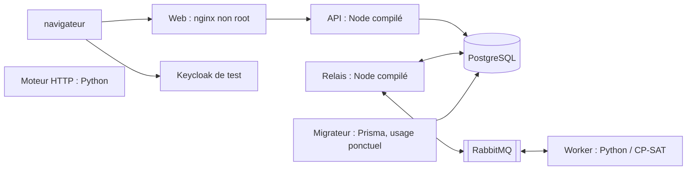

# Images de Trame — US-005 A

Cette tranche construit et teste les images sur une stack locale isolée. Elle ne publie rien dans GHCR et ne déploie aucun service sur le VPS. Le staging et la promotion restent dans US-005 B/C (#39).

## Ce qui s'exécute



Le worker et le moteur HTTP partagent la même image Python de base, avec deux commandes de lancement. Le diagnostic utilise le worker ; le service HTTP expose déjà sa sonde pour préparer les futurs appels de la PE. Il n'est pas présenté comme une PE métier livrée.

| Cible      | Dockerfile          | Commande / rôle                                     |
| ---------- | ------------------- | --------------------------------------------------- |
| `api`      | `node.Dockerfile`   | `node main.js`, HTTP sur 3000                       |
| `relay`    | `node.Dockerfile`   | `node main.js`, outbox/inbox ; aucun port           |
| `web`      | `node.Dockerfile`   | nginx sur 8080 ; fichiers Angular et proxy API fixe |
| `migrator` | `node.Dockerfile`   | Prisma `migrate deploy`, puis sortie                |
| `engine`   | `engine.Dockerfile` | `python -m trame_engine`, HTTP sur 8000             |
| `worker`   | `engine.Dockerfile` | `python -m trame_engine.worker` ; aucun port        |

La construction ne copie ni les `node_modules` ni les environnements Python du poste. Les dépendances sont réinstallées depuis les lockfiles dans le conteneur ; Nx produit les manifestes et lockfiles de runtime pour Node, y compris celui du migrateur. Les helpers TypeScript `tslib` sont déclarés explicitement dans les builds API et relais. `tsx`, Nx, uv et les outils de tests ne sont pas nécessaires aux processus applicatifs livrés.

Les bases sont figées par version et digest d'index, avec architecture Linux amd64 vérifiée : Node 26.13.0 bookworm/slim, Python 3.14.10 slim-bookworm, uv 0.13.6 et nginx/nginx-unprivileged 1.30.6 alpine. Renovate détecte les fichiers `*.Dockerfile` et suit leurs tags/digests. Python reste sur glibc : OR-Tools 9.15.6755 publie une roue CPython 3.14 manylinux x86_64 ; l'installation interdit de compiler OR-Tools depuis les sources. Le backend de construction `uv_build` est fixé à 0.13.6 pour ne pas résoudre une autre version lors de la fabrication de la roue du projet.

Sources de versions et d'usage : [Node](https://hub.docker.com/_/node), [Python](https://hub.docker.com/_/python), [uv dans Docker](https://docs.astral.sh/uv/guides/integration/docker/), [nginx non privilégié et ses registres](https://github.com/nginx/docker-nginx-unprivileged), [artefacts OR-Tools](https://pypi.org/pypi/ortools/9.15.6755/json), [sorties de déploiement Nx](https://nx.dev/docs/kb/deploying-node-projects). Les digests proviennent de `docker buildx imagetools inspect` sur ces registres, le 5 novembre 2026.

## Configuration au démarrage

Le bundle Angular reste identique d'un environnement à l'autre. nginx sert `/config.json` depuis un fichier temporaire écrit au démarrage, avec seulement :

- `WEB_AUTH_SERVER_URL` : origine HTTPS de Keycloak ; HTTP autorisé uniquement pour localhost/127.0.0.1 dans la preuve locale ;
- `WEB_AUTH_REALM` et `WEB_AUTH_CLIENT_ID` : identifiants publics ;
- le chemin API fixe `/api/v1`, sur la même origine que le front.

Ces trois variables sont obligatoires. Aucune valeur rejetée n'est journalisée. La configuration de développement du build Angular est retirée de l'image finale. nginx ne journalise pas les accès ; ses erreurs sont limitées au niveau critique pour éviter les URL et en-têtes présents dans ses diagnostics de requête. La CSP du front reste appliquée par l'application, les en-têtes mutualisés par Traefik seront vérifiés dans la tranche staging.

L'API et le relais exigent `DATABASE_URL` ; l'API exige aussi les variables OIDC existantes. Le worker exige `AMQP_URL`. Le migrateur exige une URL dédiée, sans valeur de repli locale. Aucun secret n'est un argument de build. Le fichier de topologie AMQP versionné est inclus dans les images relais et Python.

## Preuve locale et CI

Après les dépendances habituelles du dépôt et avec Docker démarré :

```bash
pnpm exec playwright install chromium
pnpm nx run infra:images-test
```

Le test construit les six cibles pour **Linux amd64**, puis démarre `compose/images-test.yml` avec un nom de projet et deux ports loopback libres. Seuls le front et Keycloak sont publiés ; PostgreSQL, RabbitMQ et les processus applicatifs restent sur le réseau privé du test. Les comptes Keycloak et le SQL de provisionnement sont des fixtures publiques montées dans cette seule stack ; ils ne sont pas intégrés aux images applicatives.

Le migrateur possède les schémas ; le compte de l'API et du relais a les droits DML nécessaires, sans droit de création de schéma. Les conteneurs applicatifs sont non root, avec racine en lecture seule, `/tmp` en mémoire, capacités retirées et sans socket Docker. Les logs de tous les services sont plafonnés. La suppression des volumes est limitée au projet de test créé par cette exécution.

Les tests couvrent configuration, permissions, migrations sans dérive, connexion réelle, calcul Python, interruption/reprise sans seconde demande, refus employé et refus d'un job étranger. Le job « Images et parcours conteneurisé » entre dans `CI OK`. Les autres tests d'intégration et les trois navigateurs du front restent exécutés dans leur job existant.

Les images locales portent un préfixe aléatoire propre au projet Compose de chaque exécution, pour que deux worktrees ne remplacent pas les images que l'autre teste. Leurs tags ne sont pas une stratégie de release : publication/signature, analyse Trivy, SBOM, digests de livraison et mesures sur le VPS arrivent dans US-005 B. Le test affiche la mémoire des conteneurs après le parcours ; cette mesure de fixture ne prouve pas le budget mémoire du futur solveur métier.

Premier relevé du 5 novembre 2026 sur Docker Desktop arm64, images applicatives amd64 : environ 181 Mio pour l'API, 175 Mio pour le relais, 156 Mio pour le worker et 1,40 Gio pour les huit conteneurs actifs au total. Le relevé vient de `docker stats --no-stream` après le petit diagnostic. Ce n'est ni un pic de calcul, ni une mesure native du VPS ; le budget de 9,2 Gio du cadrage reste à revérifier avec les deux relais et les autres services lors de la préparation du staging.

## Publication (US-005 B1)

Le workflow `.github/workflows/publish-images.yml` publie les six images de la tête de `main` sur GHCR (`ghcr.io/hachwilliam89-spec/trame-<nom>`), étiquetées par le SHA du commit. Il ne déploie rien : le staging (B2) lit le manifeste de version signé. Le plan et ses scénarios sont dans l'issue #44.

1. **Admissibilité** (`pnpm release-images gate`). Le commit publié est celui du push, qui est aussi le `sha` du jeton OIDC qui signera. Le gate attend au plus 60 minutes : l'échéance est vérifiée avant chaque lecture et avant d'autoriser, et chaque commande est bornée au temps restant. Il vérifie, sur ce commit précis :
   - « CI OK » et les trois « Analyse (…) » réussis ;
   - une analyse CodeQL traitée par catégorie ;
   - aucune alerte de code scanning haute ou critique ouverte sur `main`.

   Il s'arrête sans publier si `main` a avancé (le commit suivant sera publié par son propre run), ou si la version est déjà publiée et vérifiée.

2. **Construction et scan** (`infra/release/build-and-scan.sh`, un job par image, sans droit d'écriture) :
   - buildx exporte un layout OCI, avec le SBOM et la provenance ;
   - `release-images layout-digest` relève le digest de l'index de l'image ;
   - `oras` le copie tel quel dans un registre local, où Trivy produit un rapport complet puis applique un contrôle bloquant (critiques et hautes qui ont un correctif). Le rapport complet, vulnérabilités sans correctif comprises, est conservé 30 jours en artefact `trivy-<nom>`, même quand le contrôle bloquant échoue ;
   - `imagetools` vérifie la présence du SBOM et de la provenance.
3. **Publication** (`pnpm release-images publish`, seul job avec `packages: write` et `id-token: write`) :
   - `main` est revérifiée ;
   - les six layouts sont poussés sans reconstruction, avec un digest identique à celui du scan ;
   - chaque digest est signé sans clé avec l'annotation `commit=<sha>`, vérifié, puis lu anonymement ;
   - le manifeste de version `trame-release:<sha>` (`images.json`) n'est poussé, signé et vérifié qu'en dernier.

Vérifier une version publiée, comme le fera B2. La vérification demande `oras` et `cosign` dans le `PATH` (sous macOS : `brew install oras cosign`). Sans eux, elle échoue en nommant l'outil manquant.

```bash
pnpm release-images verify <sha>
```

Le tag du manifeste de version est résolu une seule fois en digest. La signature est vérifiée sur ce digest, puis ce même digest est téléchargé. La politique de confiance est codée dans `tools/release-images/src/lib/policy.ts`, jamais lue dans le fichier vérifié : dépôt, six noms, identité du workflow, émetteur OIDC et commit attendu.

**Sur le VPS, sans Node** (US-005 B2a, étape 3b) : `tools/release-images/verify-release.sh <sha> <fichier>` applique la même politique en shell, avec `oras`, `cosign` et `python3`. Il écrit les six `TRAME_<IMAGE>_DIGEST=sha256:…` que lit `infra/compose/staging.yml`, et seulement si tout est vérifié. Codes de sortie : 0 vérifiée, 1 refusée, 2 usage, 3 outil absent. `infra/staging/deploy.sh` l'appelle avant tout déploiement ([infra/staging/README.md](../staging/README.md)).

Le portage ne doit pas diverger : `src/lib/shell-verifier.spec.ts` le soumet aux mêmes manifestes que le vérificateur TypeScript, et compare les messages de refus. Il vérifie aussi que les arguments exacts passés à `cosign` sont ceux de `signerArguments()`, pour le manifeste puis pour chaque image. Garder les bonnes constantes sans les appliquer ferait donc échouer ces tests.

Les versions des outils (oras, cosign, Trivy, registry) et leurs sommes SHA-256 sont dans `.github/actions/release-tools/action.yml`. BuildKit et le générateur SBOM sont figés par digest dans `infra/release/pins.env`.

### Visibilité des packages

GitHub crée un nouveau package GHCR en privé par défaut. Lors de la première publication (run [42219643979](https://github.com/hachwilliam89-spec/trame/actions/runs/42219643979), commit `db4100e`), les sept packages étaient pourtant lisibles anonymement au moment du contrôle. Cela prouve qu'ils étaient publics à ce moment-là, pas qu'ils le seront toujours à leur création.

Si le téléchargement anonyme échoue, le job « Publication » nomme le package concerné. Rendre ce package public (Paramètres du package, puis Visibilité), puis relancer le job échoué : il repousse les mêmes layouts, donc les mêmes digests. La publication n'est terminée qu'après le téléchargement anonyme du manifeste de version.

### Preuve sur les PR

Le job « Images et parcours conteneurisé » de la CI rejoue, sur un registre local et sans GHCR, la construction et le scan d'une image par le même script, puis une signature avec une clé jetable :

- vérification avec l'annotation du commit ;
- refus d'un autre commit ;
- lecture anonyme.
